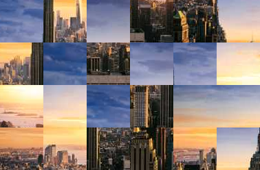

# Mini_Projects
# Image Puzzle Solver

Rearranges a picture cut into shuffled, equal-sized tiles by matching their edge colours.

## How to run
```bash
python3 -m pip install numpy pillow
python3 puzzle_solver.py shuffle photo.jpeg jumbled.png --rows 4 --cols 6
python3 puzzle_solver.py solve jumbled.png solved.png --rows 4 --cols 6
```

## Results
| Original | Jumbled | Solved |
|---|---|---|
|  |  |  |

## Limitations
- Does not solve interlocking jigsaw pieces
- Plain or repetitive areas may be placed incorrectly
- The number of rows and columns must be provided
